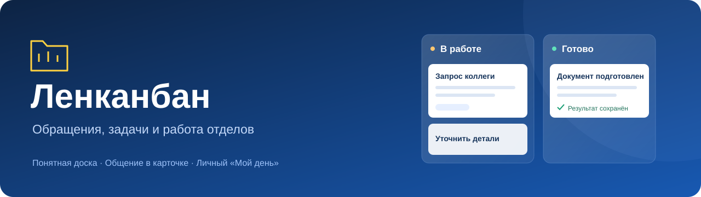
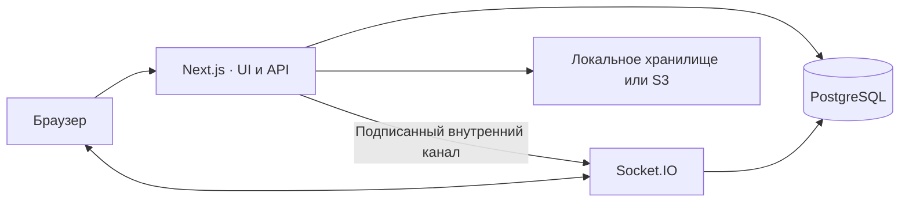

# Ленканбан




**Обращения, работа отделов и личное планирование — в одном рабочем пространстве.**

Ленканбан помогает передавать задачи между сотрудниками и отделами, вести обсуждение рядом с заявкой и видеть, что требует внимания. Доски показывают состояние работы, карточка хранит контекст, а «Мой день» оставляет место для личных записей.

**[Скачать презентацию проекта (PowerPoint, 14 слайдов)](docs/presentations/Lenkanban-product-case.pptx)** — идея продукта, решаемая проблема, мой вклад, примеры процессов, технологии и преимущества публичного кода.

[Возможности](#возможности) · [Архитектура](#архитектура) · [Локальная разработка](#локальная-разработка) · [Проверки](#проверки) · [Развёртывание](#развёртывание)

## Возможности

| Область | Что можно делать |
| --- | --- |
| **Отделы и доски** | Работать с обращениями по направлениям, переключаться между представлениями, фильтровать и искать заявки, просматривать архив. |
| **Карточка обращения** | Заполнять тему и описание, выбирать срочность, видеть автора и исполнителя, работать с наблюдателями, связанными обращениями и историей изменений. |
| **Переписка и файлы** | Обсуждать заявку в её карточке, прикладывать документы и изображения, открывать доступные вложения. Внутренние сообщения имеют отдельные ограничения видимости. |
| **Исполнение** | Брать обращения в работу и выполнять разрешённые действия по маршруту. Доступность действия зависит от роли сотрудника, конкретной доски и состояния заявки. |
| **Уведомления** | Видеть ленту событий и счётчики по доскам и обращениям; отмечать уведомления прочитанными. Просмотр карточки подтверждает только соответствующий видимый пользователю снимок изменений. |
| **Поиск и календарь** | Находить доступные обращения и работать с календарным представлением задач. |
| **Мой день** | Вести личные записи по датам с календарём, сохранением и контролем конфликтующих изменений. API выбирает владельца из текущей сессии; административный доступ к чужим записям этим маршрутом не предоставляется. |
| **Управление доступом** | Настраивать отделы, группы, профили полномочий и права на доски. Разделять право увидеть обращение, создать его и исполнять. |

### Пример рабочего процесса: «Безнал ОП»

Для взаимодействия продаж и бухгалтерии предусмотрен отдельный маршрут: **«Ждут обработки» → «Со счётом» → архив**. В нём используются общая карточка, переписка и вложения. Исполнитель готовит счёт, автор или сотрудник с соответствующим правом подтверждает результат; возврат на доработку требует причины и сохраняет контекст обращения.

Доступ к общей доске не отменяет ограничения персональных заявок и внутренней переписки.

## Архитектура

Приложение состоит из веб-сервера Next.js и отдельного сервера Socket.IO. PostgreSQL хранит бизнес-данные; файлы размещаются в отдельном приватном хранилище.



| Слой | Технологии |
| --- | --- |
| Интерфейс | React 19, TypeScript, Tailwind CSS 4, Radix UI |
| Веб-приложение | Next.js 15, NextAuth |
| Данные и формы | TanStack Query, React Hook Form, Zod |
| База данных | PostgreSQL, Prisma 6 |
| Realtime | Socket.IO 4 |
| Диагностика | Pino, интеграция Sentry, Activity для истории бизнес-действий |
| Проверки | Vitest, Testing Library, Playwright, ESLint, TypeScript |

Серверные проверки доступа используются при чтении карточек, переписки, файлов и уведомлений. Команды жизненного цикла учитывают версию обращения и идентификатор операции, чтобы повтор запроса не создавал повторный результат. Уведомления, просмотр изменений и просмотр очереди — отдельные механизмы.

## Локальная разработка

Нужны **Node.js 22.22.2+ ветки 22**, npm и Docker Compose. PostgreSQL и Mailpit запускаются в контейнерах, Next.js и Socket.IO — на хосте.

### 1. Подготовьте проект

```sh
git clone https://github.com/impossi8le/lenkanban.git
cd lenkanban
npm ci
cp .env.example .env
```

В PowerShell вместо последней команды: `Copy-Item .env.example .env`.

Шаблон [`.env.example`](.env.example) настроен на локальную базу `kanban_local` по адресу `127.0.0.1:55432`. Замените placeholders `NEXTAUTH_SECRET` и `INTERNAL_EMIT_SECRET` двумя разными случайными значениями: выполните следующую команду отдельно для каждого секрета и перенесите результат в `.env`.

```sh
node -e "console.log(require('node:crypto').randomBytes(32).toString('hex'))"
```

Для `ATTACHMENT_LOCAL_DIR` задайте абсолютный путь к собственному каталогу вложений, например `C:/lenkanban-dev/attachments` или `/tmp/lenkanban-dev/attachments`. Создайте этот каталог и разрешите процессу Node.js запись в него.

### 2. Поднимите локальную инфраструктуру

```sh
docker compose -f compose.local.yaml up -d --wait
npm run prisma:generate
npx prisma migrate deploy
```

[`compose.local.yaml`](compose.local.yaml) выделяет локальные порты для PostgreSQL и Mailpit. Команды миграции в этом примере предназначены для новой локальной базы. База должна разрешать расширение `pg_trgm`, используемое поисковыми индексами.

### 3. Запустите приложение

```sh
npm run dev -- --hostname localhost --port 3555
```

Скрипт запускает **Next.js и Socket.IO вместе** и завершает оба процесса при остановке. Дополнительный `socket:dev` одновременно с ним не нужен.

Откройте **http://localhost:3555/sign-up**, создайте собственную тестовую учётную запись и войдите. Локальная регистрация создаёт обычного пользователя; организация, профили и доступ к доскам настраиваются отдельно. Mailpit доступен по **http://localhost:8025** для проверки исходящей почты.

Используйте `localhost` последовательно в публичных URL приложения и Socket.IO: origin и cookies должны соответствовать конфигурации. Настройки S3 и Sentry подключаются отдельно, базовый локальный запуск их не требует.

Остановка инфраструктуры с сохранением данных:

```sh
docker compose -f compose.local.yaml stop
```

## Проверки

```sh
npm run typecheck
npm run lint
npm test -- --maxWorkers=2 --exclude="tests/integration/**"
npm run test:mail
npm run build
```

| Команда | Назначение |
| --- | --- |
| `npm run test:watch` | Vitest в режиме наблюдения |
| `npm run test:integration` | Интеграционные проверки; только с отдельной разрешённой тестовой БД |
| `npm run test:e2e` | Сценарии Playwright; требуются браузеры Playwright и изолированное тестовое окружение |
| `npm run socket:build` | Сборка отдельного Socket.IO-сервера |

Unit/component-проверки и реальная интеграция с PostgreSQL проверяют разные границы системы. Для integration/E2E нужна отдельная тестовая база.

## Структура проекта

```text
src/
├── app/                  # Страницы App Router и HTTP API
├── components/           # Карточки, доски, формы и общие элементы UI
├── features/my-day/      # Личный дневник и календарь
├── lib/                  # Доступ, бизнес-команды, хранение и контракты
├── socket/               # Socket.IO, комнаты и внутренний канал событий
└── test/                 # Общая настройка тестов
prisma/                   # Схема и миграции PostgreSQL
scripts/                  # Разработка, сборка и служебные команды
tests/                    # Интеграционные и почтовые проверки
e2e/                      # Браузерные сценарии
deploy/                   # Инструменты развёртывания
docs/                     # Контракты и документация проекта
```

## Развёртывание

`Dockerfile` содержит отдельные цели **`runner`** для Next.js standalone и **`socket`** для Socket.IO. PostgreSQL и приватное хранилище файлов разворачиваются отдельно; внешний доступ организуется через reverse proxy и HTTPS.

Публичные `NEXT_PUBLIC_*` значения задаются при сборке. Серверные секреты передаются окружением во время запуска; внутренний канал событий требует общего секрета веб- и socket-процессов. Порт внутреннего канала не предназначен для публичного доступа.

Обновление рабочей установки включает проверку схемы, резервную копию PostgreSQL и файлов, проверку восстановления, согласованное применение миграций и проверку обоих серверов после переключения. `db:push` и `db:reset` не являются процедурой обновления production.

### Примечание для разработки

Чистый bootstrap с пустой базы ещё требует отдельной проверки. В текущем снимке нет `prisma/seed.ts` и отдельной команды создания первого администратора, поэтому `db:seed` и `db:reset` не входят в инструкцию запуска.

Визуальная проверка снимка неполна: 134 PNG проверены по отдельности, но канонической матрице не хватает 332 файлов. Полное прохождение визуальной регрессии не заявляется. О составе исходного снимка — в [PUBLIC_SOURCE](docs/PUBLIC_SOURCE.md).

## Развитие продукта

Следующие документы сохраняют обсуждение от **29.10.2026**: что ещё сделать,
что проверить и какие решения остаются открытыми. Они не являются отчётами
о завершённой реализации.

| Направление | Что предстоит |
| --- | --- |
| **Претензии клиентов и ОЗОК** | Разбор от диспетчера до результата, гибкая карточка и категории, история клиента, мастера, кураторы, согласования, возврат и напоминания о созвонах. [Подробная проработка](docs/CLAIMS_OZOK_BACKLOG_2026-10-29.md). |
| **Проверки и поиск** | Проверить текущие пользовательские пути и поиск на конкретных примерах; по результатам определить исправления. |
| **Общая основа отделов** | Развить шаблоны досок и общие элементы с сохранением настроек отделов, доработать «доску git» после уточнения её назначения. |
| **Диагностика и обратная связь** | Улучшить обработку ошибок и предложений, выявлять критические проблемы, объяснить сотрудникам кнопку «Сообщить о проблеме» сверху справа. |
| **Ежедневная работа и внедрение** | Дни рождения мастеров от робота для нужной аудитории, развитие «Моего дня», измерение нагрузки и кэширование, отчёты сотрудников и дальнейшее внедрение. |

[Общий план доработок, проверок и открытых вопросов](docs/PRODUCT_ROADMAP_2026-10-29.md).
Excel-отчёт ОЗОК остаётся отложенным. Для работы с существующим модулем прослушки
предусмотрена доработка копирования телефона; отдельное хранилище звонков не задано.

## Участие в разработке

Начните с существующего поведения и небольшого воспроизводимого сценария. Для исправлений указывайте ожидаемый результат и проверку; для новых возможностей — маршрут пользователя и границы доступа. Не добавляйте в issue, тестовые фикстуры и скриншоты реальные обращения, переписку, документы, пароли или токены.

Состав исходников и назначение исторической документации описаны в [PUBLIC_SOURCE.md](docs/PUBLIC_SOURCE.md).
