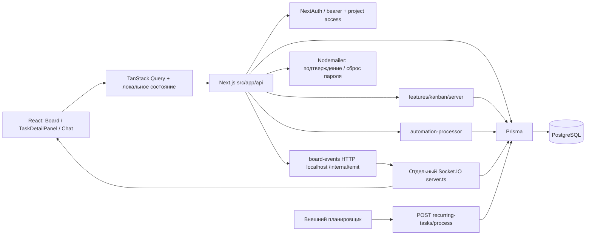
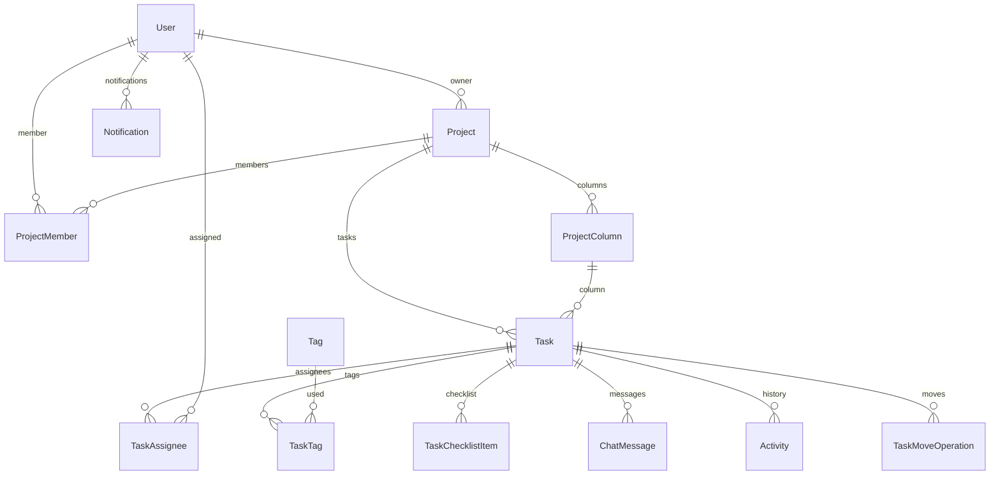

# Архитектура ЛЕНКАНБАН: карта для изменений

Дата: 20.10.2026. Источник истины этого документа — **корневые `src/` и `prisma/`** в `D:/Lenkanban`; вложенный `lenkanban/` исключён. Документ дополняет [вики](../wiki/architecture.md), [эксплуатацию](../wiki/operations.md) и [каталог](../wiki/catalog.md). Аудит статический: наличие кода подтверждено, работа удалённой среды, доставка писем, миграции рабочей БД и успешность тестов здесь не заявляются. Ссылки `файл:строка` ниже даны относительно корня репозитория; номера относятся к снимку аудита.

## 1. Общая схема и границы

Это модульное приложение Next.js App Router с преимущественно прямым доступом HTTP handlers к Prisma. Выделенный доменный слой наиболее развит у перемещения задач; остальные правила распределены между route handlers, `src/lib` и компонентами. Отдельный Socket.IO-процесс обслуживает комнаты досок, задач и пользователей. PostgreSQL хранит бизнес-данные, API-токены и rate limits. Выделенной очереди заданий или outbox в Prisma-схеме нет.

HTTP подтверждает запись в БД; Socket.IO сообщает об изменении, но не является журналом событий. Доставка через HTTP-мост ограничена таймаутом 1 секунда, ошибки только журналируются (`src/socket/board-events.ts:8`). После потери соединения состояние нужно восстанавливать чтением API; нельзя считать событие гарантированно доставленным.

## 2. Где находится функциональность

| Область | Основные файлы | Что менять здесь |
| --- | --- | --- |
| Оболочка | `src/app/layout.tsx`, `(dashboard)/layout.tsx`, `src/providers/*` | Сессия, темы, QueryClient, общий layout |
| Страницы | `src/app/(dashboard)` | `/projects`, `/my-tasks`, `/inbox`, `/messages`, `/analytics`, `/settings`, `/admin/*` |
| Доска | `src/app/(dashboard)/projects/[id]/board`, `src/components/kanban/Board.tsx` | Загрузка, фильтры, переключение board/table/calendar, подписки, legacy DnD |
| Новый DnD | `src/features/kanban/{dnd,model,rank,server,accessibility}` | План перемещения, очередь, ранги, блокировки, версии и идемпотентность |
| Карточка | `src/components/task/TaskDetailPanel.tsx`, `src/lib/task-{queries,detail-dto}.ts` | Поля, сохранение, DTO; отдельная страница и intercepted modal используют общий сценарий |
| Обсуждение | `src/components/task/TaskChatPanel.tsx`, `src/hooks/useTaskChat.ts`, `src/socket/server.ts` | Сообщения, подтверждение, повтор, прочтение, реакции, typing |
| История | `src/lib/activity-logger.ts`, `src/app/api/activities/route.ts` | Значимые действия и отображение активности |
| Шаблоны/правила/повторения | `src/components/{templates,project-templates,automation,recurring}`, одноимённые API | Настройка процесса и создание задач |
| Представления/массовые действия | `src/components/{saved-views,views,bulk}`, API `saved-views`, `tasks/bulk*` | Пользовательские фильтры, сортировка, массовые мутации |
| Доступ | `src/lib/{nextauth,require-user,require-api-user,project-access}.ts` | Вход, текущий пользователь, API-токены, проектные права |
| Интеграции | `src/lib/{email,notifications,notification-triggers,logger,sentry}.ts` | SMTP, уведомления, журналы и наблюдаемость |

Название `src/providers/app-clerk-provider.tsx` — исторический остаток с комментарием об удалении Clerk. Активный layout использует `AuthProvider` с NextAuth. `src/lib/auth.config.ts` — ещё одна конфигурация credentials; поиск импортов в `src` не выявил её использования. Рабочая конфигурация — `src/lib/nextauth.ts`; при изменении входа начинать с неё, не с файла, название которого кажется подходящим.

## 3. Данные, связи и инварианты

Полная схема в локальном снимке: `prisma/schema.prisma`. Исходник схемы не включён в опубликованный пакет документации; это указатель для работы с исходниками, а не ссылка на опубликованный файл. Бизнес-агрегат — `Project`; пользователь владеет проектом и/или входит через `ProjectMember`.

| Сущность | Правила и последствия изменения |
| --- | --- |
| `User` | Уникальный email, пароль bcrypt, глобальная роль, токены подтверждения/сброса. `Account`, `Session`, `VerificationToken` присутствуют в схеме, но текущая сессия JWT, провайдер credentials |
| `Project` | `ownerId`, `boardRevision`, флаг `dndV2Enabled`; каскадно удаляются задачи, колонки, участники, правила и представления |
| `ProjectMember` | Уникальная пара проект/пользователь; `MEMBER` или `PROJECT_ADMIN`; `addedById` необязателен |
| `ProjectColumn` | Уникальные `(projectId, position)` и `(projectId, workflowKey)`; удаление колонки с задачами ограничено FK; `column-deletion.ts` блокирует последнюю/непустую колонку, автоматического переноса при удалении нет |
| `Task` | `columnId` — каноническая колонка; `status` — совместимость с workflow. `rank` фиксированной длины и уникален в колонке; `position` поддерживается для совместимости; `version` используется для конкурентных мутаций |
| Исполнители и теги | Связи многие-ко-многим через `TaskAssignee` и `TaskTag`; в БД нет составного FK, который сам запретит чужой проект для тега/колонки. Проверка принадлежности — ответственность сервиса/handler |
| `ChatMessage` | Глобально уникальный необязательный `clientId` для повтора отправки; attachments/reactions/mentions/readBy — JSON; отдельного `updatedAt` нет |
| `Activity` | История на задаче; удаляется вместе с задачей и при каскадном удалении автора. Это история UI, а не неизменяемый журнал аудита |
| `Notification` | Персональная запись, тип/ссылка/metadata, read/readAt; не email-очередь |
| `TaskMoveOperation` | Уникальный operationId, хеш запроса, сохранённый JSON ответа; повтор возвращает тот же результат, несоответствие тела — конфликт |
| Шаблоны | `TaskTemplate` привязан к проекту; `ProjectTemplate` — к создателю, конфигурация в JSON. Изменение формы JSON требует совместимости со старыми шаблонами |
| `RecurringTask` | Шаблон плюс frequency/interval/daysOfWeek/dayOfMonth/startDate/endDate/nextRunAt; нет отдельной таблицы запусков/уникального ключа периода |
| `AutomationRule` | trigger строкой, conditions/actions JSON. Нужна синхронная корректировка формы редактора, API-валидации и процессора |
| `SavedView` | Проект + создатель, viewType/filters/sortBy/isDefault. Флаг default не защищён уникальным ограничением в схеме |
| `ApiToken`, `RateLimit` | Хеш пользовательского bearer-токена, revokedAt/lastUsedAt; счётчики ограничения запросов в той же PostgreSQL |

Схема позволяет несколько исполнителей, не содержит сущностей подразделения, LDAP identity, лида, отчётного периода, чека, подтверждения передачи. Требования из [ORG_ACCESS_MAIL_ROADMAP](../ORG_ACCESS_MAIL_ROADMAP.md) и [почтового backlog](../KANBAN_MAIL_BACKLOG.md) остаются целевой моделью; готового basemail/IMAP импортера в исследованных каталогах не обнаружено.

## 4. Авторизация и роли

`nextauth.ts` проверяет credentials, rate limit и `emailVerified`; JWT живёт 7 дней. Callback session перечитывает глобальную роль из БД, клиентская session update не определяет права. `requireDbUser()` заново ищет пользователя по email сессии. `requireApiUser(request)` сначала проверяет bearer (хеш, существование, revokedAt), затем cookie, если заголовка bearer нет. При неверном bearer возврата к cookie не происходит.

| Роль по `project-access.ts` | Читать | Писать | Участники |
| --- | --- | --- | --- |
| Посторонний USER | Нет | Нет | Нет |
| MEMBER | Да | Да | Нет |
| PROJECT_ADMIN | Да | Да | Да |
| Владелец | Да | Да | Да |
| Глобальный ADMIN | Да | Да | Да |

Нет роли «только читать», ограничения «только мои задачи» и видимости по подразделениям. `canManageMembers` нельзя автоматически трактовать как полномочие менять/удалять сам проект: handler может дополнительно проверять владельца. Часть endpoints пишет условия owner/member непосредственно в Prisma-запросе, поэтому расширение `project-access.ts` само по себе не расширит всю систему. Socket.IO также имеет собственную проверку: см. A-04.

`src/middleware.ts:68` намеренно исключает `/api/*`: HTTP handlers обязаны проверять доступ сами и отдавать JSON. Middleware не компенсирует пропущенную проверку. Настройки UI и скрытая кнопка не являются границей доступа.

## 5. HTTP API: карта контрактов

Префикс всех путей — `/api`. Методы сверены по экспортам handlers; детали тела и статусов следует читать в соответствующем `src/app/api/**/route.ts`, а [OpenAPI](../../openapi.yaml) использовать как справочник, полнота которого отдельно не подтверждена.

| Семейство | Реализованные пути и методы |
| --- | --- |
| Вход | `auth/[...nextauth]` GET/POST; `auth/register`, `auth/login`, `auth-login`, `auth/forgot-password`, `auth/reset-password`, `auth/resend-verification` POST; `auth/verify-email` GET |
| Пользователи | `users` GET; `user/profile` PATCH; `admin/me`, `admin/users`, `admin/projects` GET; `admin/users/[id]` PATCH |
| API-токены | `tokens` GET/POST, `tokens/[id]` DELETE |
| Проекты | `projects` GET/POST, `projects/[id]` GET/PATCH/DELETE |
| Участники | `projects/[id]/members` GET/POST; `.../members/[memberId]` PATCH/DELETE |
| Колонки | `projects/[id]/columns` GET/POST; `.../columns/[columnId]` PATCH/DELETE; `.../columns/reorder` PATCH |
| Задачи | `tasks` GET/POST, `tasks/[id]` GET/PATCH/DELETE, `tasks/[id]/move` POST |
| Массовые операции | `tasks/bulk` PATCH и `tasks/bulk-update` POST — два отдельных контракта, оба учитывать при изменении workflow |
| Поля задачи | `tasks/[id]/assignees` PUT, `.../tags` PUT, `.../attachments` PATCH; `.../checklist` GET/POST, `.../checklist/[itemId]` PATCH/DELETE |
| Сообщения | `tasks/[id]/messages` GET/POST, `.../messages/read` POST, `messages/unread` GET; `tasks/[id]/comments` GET/POST — deprecated заглушки |
| Теги / история / аналитика | `tags` GET/POST, `tags/[id]` PATCH/DELETE, `activities` GET, `analytics` GET |
| Уведомления | `notifications`, `notifications/unread-count` GET; `notifications/[id]`, `notifications/mark-all-read` PATCH |
| Шаблоны задач | `templates` GET/POST, `templates/[id]` GET/PATCH/DELETE, `templates/[id]/use` POST |
| Шаблоны проектов | `project-templates` GET/POST, `project-templates/[id]` DELETE, `.../[id]/use` POST |
| Повторения | `recurring-tasks` GET/POST, `recurring-tasks/[id]` GET/PATCH/DELETE, `recurring-tasks/process` POST |
| Автоматизации | `automation-rules` GET/POST, `automation-rules/[id]` GET/PATCH/DELETE |
| Представления | `saved-views` GET/POST, `saved-views/[id]` GET/PATCH/DELETE |
| Диагностика | `test-socket-emit` GET — публикует событие по taskId, см. A-08 |

`src/lib/api.ts` распаковывает `{ success, data }`, но допускает старый формат ответа; ошибки несут `status` и `payload`. Нельзя считать все endpoints одинаковыми: некоторые используют `requireDbUser` (cookie), другие `requireApiUser` (cookie/bearer). Для нового внешнего клиента проверить именно целевой endpoint.

## 6. Состояние, кэш и real-time

- `QueryProvider` создаёт QueryClient один раз на mount, `staleTime = 60 секунд`. Ключи доски: `['tasks', projectId]`, `['columns', projectId]`, `['project-members', projectId]`, `['tags', projectId]`, `['project', projectId]`; история — `['activities', taskId]`, счётчики — `['unread-counts']`.
- `Board.tsx` держит собственные массивы tasks/columns для оптимистичного UI поверх Query cache. Изменение API DTO затрагивает также эту копию состояния и адаптеры нормализации.
- `useUIStore` хранит только свёрнутость sidebar и activeProjectId, без persist. Это не хранилище задач.
- `useTaskDraft` и `useChatDraft` сохраняют текст в localStorage с пользовательской/задачной привязкой. Восстановление черновика и подтверждённая сервером запись — разные состояния. Чувствительный текст остаётся на устройстве; очистка браузера удаляет черновики.
- `useProjectBoard` разделяет одну комнату между доской и intercepted task panel, считает подписчиков, повторяет join после reconnect и ждёт ACK. Версии задачи/доски фильтруют устаревшие снимки; `task:moved` требует чтения канонического состояния.
- `useTaskChat`/`TaskChatPanel` имеют task room, ACK и clientId. Повтор подключения требует GET: сервер не воспроизводит пропущенные события. HTTP POST сообщений и socket send — два пути записи, их контракты должны совпадать.
- Доска и карточка используют `getSocketInstance()`; уведомления имеют второй singleton в `useNotificationSocket`. У второго fallback URL — исторический внешний домен, у первого — текущий origin. Настройка NEXT_PUBLIC_SOCKET_URL обязательна для воспроизводимого развёртывания.

Канонический move: POST → auth/access → проверка тела → `move-task-service` → транзакционный Prisma repository → ранги/версии/boardRevision/Activity/TaskMoveOperation → ответ → HTTP-мост `task:moved`. Флаг `Project.dndV2Enabled` выбирает UI-адаптер; legacy интерфейс тоже следует проверять. Для программной смены колонки используется `task-relocation.ts`, а не прямое обновление `status`. `column-deletion.ts` отвечает за безопасный отказ при удалении последней/непустой колонки; сначала задачи нужно переместить отдельно.

## 7. Автоматизации, задания и интеграции

`processAutomationRules` выбирает активные правила проекта по trigger, читает снимок задачи, проверяет все conditions и последовательно выполняет actions. Триггеры вызываются из создания/редактирования задач, назначения и тегов. Действия: notify_assignees, notify_creator, add_tag, remove_tag, change_priority, assign_user, move_to_column, add_comment. Нет устойчивой очереди, run ledger или транзакционного outbox; route handlers запускают правила после записи через `.catch(...)` (`src/app/api/tasks/route.ts:277`). HTTP-успех не подтверждает выполнение правил. У процессора есть агрегирование ошибок, но нет автоматического возобновления после перезапуска.

Повторения запускает внешний POST. В `src/prisma` нет собственного cron worker. Процессор выбирает наступившие записи, создаёт задачу в первой колонке, добавляет связанные данные и сдвигает nextRunAt. Поведение catch-up: один экземпляр на запись за вызов, следующий срок считается от прежнего nextRunAt; длительное отставание может догоняться серией запусков. Часовой пояс не хранится в модели; расчёты используют локальную зону Node.js.

SMTP через Nodemailer обслуживает подтверждение email и сброс пароля. Адреса строятся из `APP_URL`; транспорт ленивый. Наличие SMTP-параметров не доказывает доставку. Уведомления хранятся в БД; обычные триггеры используют `notifications.ts`, но автоматизации создают Notification напрямую и обходят общий emit/rate limit.

Вложения хранятся в JSON как метаданные URL/name/size/mime. UI карточки обращается к direct upload, чат — к presign + PUT в объектное хранилище; серверных upload handlers в корневом `src` нет (A-01). Файлы не хранятся в Prisma, удаление метаданных не равнозначно удалению объекта.

`src/socket/server.ts` — самостоятельный сервер; `src/socket/setup.js` содержит другую реализацию setupSocketIO, но не импортируется из `src`. Это не взаимозаменяемые файлы: контракты/проверки отличаются. `io-instance.js`/`.mjs` не соединяют память разных процессов. Уведомления из Next.js требуют межпроцессного транспорта (A-05).

## 8. Карта изменения бизнес-правил

| Запрос на изменение | Начать здесь | Обязательно проверить вместе |
| --- | --- | --- |
| Новая роль / LDAP / подразделения | Prisma User/ProjectMember + `require-user`, `project-access`, `require-api-user` | Все прямые owner/member where-фильтры API и страниц, admin handlers, socket `canUserAccessProject`, перечни пользователей/исполнителей |
| Новый workflow / статусы | `move-contract.ts`, ProjectColumn.workflowKey, миграция | Фильтры, аналитика, таблица/календарь, bulk оба API, шаблоны, recurring, автоматизации; не вводить новый статус только в UI |
| Новое поле задачи | Prisma Task + `validators.ts`, DTO/query, route.ts | Формы/панель, optimistic copies, socket payload, шаблоны, recurring, export, bulk, Activity |
| Новое правило автоматизации | RuleDialog + API automation-rules + processor | Семантика snapshot между actions, права params, идемпотентность повторов, версия/emit/Activity |
| Изменение перемещения | `features/kanban/server` и rank/model | Legacy и V2 DnD, меню перемещения, удаление колонки, PATCH задачи, bulk, automation, конфликты 409 и повтор operationId |
| Новый канал уведомления | `notifications.ts`, `notification-triggers.ts` | Отдельный процесс, персональные комнаты, адресаты, rate limit, непрочитанные, восстановление после reconnect |
| Расписание | API recurring-tasks и process | Три копии вычисления дат (`recurring-tasks/route.ts`, `[id]/route.ts` и `process/route.ts`), timezone, month-end, интервал недели, сбой/два worker |
| Новый тип вложения | UI direct/presign, отсутствующий backend, attachment types | Чужой проект, ограничения размера/MIME, сроки URL, cleanup объектов, скачивание и JSON DTO |
| Импорт почты / бизнес-передача | Сначала отдельный контракт и модель | Ключ источника/дедупликация, единственный ответственный если нужен, права, аудит, повторы, сохранение вложений, принятие/возврат |

## 9. Подтверждённые замечания и готовые критерии issue

Приоритеты: P1 — исправить до зависимости от функции/внешнего выпуска; P2 — плановое исправление с регрессией. Наблюдения статические; где влияние зависит от окружения, это указано явно.

| ID / приоритет | Доказательство и эффект | Критерии приёмки |
| --- | --- | --- |
| **A-01 P1: нет backend загрузки** | `src/components/task/TaskAttachments.tsx:59` вызывает `/api/uploads/direct`, `TaskChatPanel.tsx:57` — `/api/uploads/presign`; соответствующих root handlers нет. Внешний proxy/upload service не подтверждён | В чистой установке файл загружается из карточки и чата, доступен после reload; чужой проект отклоняется; размер/MIME валидируются; контракт storage и его конфигурация документированы |
| **A-02 P1: cron без секрета открыт** | `src/app/api/recurring-tasks/process/route.ts:24` проверяет auth только при truthy CRON_SECRET; API исключён middleware | Без секрета processor fail-closed; без/с неверным bearer отказ; верный secret запускает работу; тесты трёх веток |
| **A-03 P1: повторения не идемпотентны** | Выбор due в `process/route.ts:31`, commit Task `:66`, checklist `:97` и продвижение расписания `:161` разнесены. Сбой после commit оставляет прежний nextRunAt; второй запуск создаёт ещё Task. Конкурирующие вызовы не резервируют запуск | Уникальный запуск по recurringTaskId + scheduledAt; два параллельных worker создают одну полностью заполненную задачу; fault после создания и повтор не дают дубля; задача/связи/продвижение фиксируются атомарно |
| **A-04 P2: права ADMIN различаются** | `src/lib/project-access.ts:15` разрешает глобальному ADMIN все проекты; `src/socket/server.ts:46` учитывает только owner/member, а `:194` применяет это к project:join | Одинаковая матрица HTTP/socket для постороннего, member, project admin, owner, global admin; тест global admin вне состава проекта читает комнату и чат согласно утверждённой политике |
| **A-05 P1: разные транспорты уведомлений** | `src/lib/notifications.ts:28` импортирует server и эмитит в локальный io; `src/socket/server.ts:634` слушает только при прямом запуске. При отдельных Next.js/socket процессах это другой объект io. Автоматизации `automation-processor.ts:243` пишут Notification напрямую | Две отдельные ОС-процесса, уведомление из HTTP и automation приходит правильному пользователю; другой пользователь его не видит; reconnect восстанавливает список/счётчик; единый транспорт и проверка ошибки доставки |
| **A-06 P2: автоматизации обходят инварианты мутаций** | `automation-processor.ts:341` меняет priority без version/Activity/emit и не обновляет task snapshot; `:351` назначает пользователя напрямую, `:407` создаёт чат без общего chat emit. Успешный HTTP может оставить другие сессии со старым состоянием; следующие actions видят старый snapshot | Общие mutation services для HTTP/automation, приоритет/исполнитель/комментарий появляются во второй сессии, пишут Activity где требуется, корректно увеличивают version; условия и порядок действий имеют определённую snapshot-семантику |
| **A-07 P2: календарный расчёт ошибается на границах** | `process/route.ts:260` не учитывает interval в weekly с daysOfWeek; `:268` вызывает setMonth до установки безопасного дня (31 января + месяц перепрыгивает февраль). Тот же код есть при создании и PATCH расписания: `recurring-tasks/[id]/route.ts:262`, `:270` | Детерминированные тесты 31 января→февраль, високосный год, weekly interval=2 с выбранными днями, timezone/DST и endDate; одна реализация расчёта для всех API |
| **A-08 P2: публичная диагностика публикует данные** | `src/app/api/test-socket-emit/route.ts:6` не проверяет пользователя/проект, читает task и эмитит; ответ раскрывает projectId для известного taskId. Сам текст задачи HTTP не возвращает | В production route отсутствует/отключён либо защищён admin+project access; анонимный/посторонний не вызывает событие и не получает идентификаторы |
| **A-09 P1 при внешней доступности: мост без аутентификации** | `src/socket/internal-emit-handler.ts:26` принимает произвольные event/roomId/data; `src/socket/server.ts:636` listen без loopback host. Внешняя доступность не установлена, CORS не защищает серверный POST | Мост закрыт от публичной сети, имеет проверяемую межсервисную авторизацию/allowlist/лимит тела; неизвестный event/room отклоняется; разрешённый вызов сохраняет работу доски |
| **A-10 P2: batch уведомлений выбирает неточный набор** | `src/lib/notifications.ts:81` после createMany выбирает последние записи адресатов за 5 секунд с take, а не точные созданные ID. При параллельных batch набор может включить чужую запись и пропустить свою | Два одновременных batch одинаковым адресатам публикуют каждый созданный ID из собственного набора; старые записи не эмитятся повторно |

Дополнительное подтверждённое ограничение: `src/lib/email.ts:25` отключает проверку TLS-сертификата (детали и выпуск — в [operations](../wiki/operations.md)). `src/lib/socket-client.ts:20` логирует содержимое событий в исходниках; production compiler removeConsole в next.config.mjs исключает info/log, поэтому это наблюдение относится к dev и требует проверки итоговой сборки, а не отдельное подтверждённое production-раскрытие.

## 10. Что остаётся проверить исполнением

Эта архитектурная карта не подтверждает успешный build или применение миграций к существующей БД. Нужно отдельно проверить обе DnD ветки, прямую страницу и modal карточки, два параллельных пользователя, потерю сети, разные роли, auth lifecycle, SMTP и storage. Для статически выявленных A-01–A-10 выполнение воспроизведения уточнит пользовательский эффект; отсутствие наблюдаемой ошибки в одной конфигурации не устраняет подтверждённую ветку исходников.

Потенциальный рост нагрузки: `tasks GET` без limit возвращает весь проект (`src/app/api/tasks/route.ts:132`), UI доски запрашивает такой снимок. Это подтверждённый контракт, но деградация на конкретном количестве задач без измерения — предположение. Перед оптимизацией измерить SQL/объём DTO/время рендера на репрезентативном обезличенном наборе; затем согласовать пагинацию/виртуализацию так, чтобы DnD не терял соседей вне страницы.

Указатели src/... и prisma/... в этом документе относятся к локальному снимку исходников. Ветка публикации аудита содержит документацию и результаты проверок; исходники приложения не опубликованы. Локальное наличие файла и ссылка в отчёте не означают его наличие в GitHub.

